# Bookmark Graveyard

*Raise your bookmarks from the dead.*

Bookmark Graveyard turns the X bookmarks you never go back to into a weekly markdown brief and an
optional two-host podcast. It is self-hosted: you run it yourself and bring your own keys. It signs
in with your X account, reads the posts you saved and the articles, images and videos behind them,
and has [Grok](https://x.ai) write up what you saved. It is for anyone whose bookmarks are a pile
they never open.

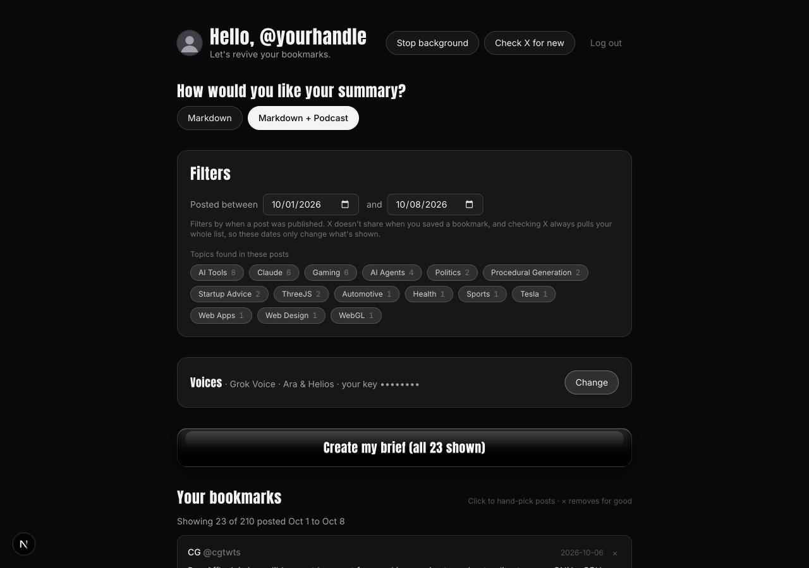

[▶ Listen to 30 seconds of a real brief](docs/sample-brief.mp3)

**Private by design:** your data stays in your own Supabase project; the only services that see it
are the ones you bring keys for.

## What you need

You need three accounts, one optional account, and a computer with [Node.js](https://nodejs.org) 22
or newer (npm comes with it) and [git](https://git-scm.com).

An API key is a long password that lets this app use a service for you. You make one on each
service's website and paste it into a text file on your own computer, or into your host's settings.

| Account | What you copy from it | What it costs |
| --- | --- | --- |
| [Supabase](https://supabase.com) | Your project URL and a secret key. This is your database and file storage. | The free tier is enough. |
| [X Developer Console](https://console.x.com) | An OAuth 2.0 Client ID and Client Secret. This is how you sign in and how the app reads your bookmarks. | Pay-per-use. Reading bookmarks costs $0.001 per post, so $5 buys 5,000 post reads. |
| [xAI console](https://console.x.ai) | One API key. [Grok](https://x.ai) tags your bookmarks, writes the brief and can speak the podcast. | Pay-as-you-go. Typically under $1 a month for analysis, plus about $0.20 per podcast episode with Grok Voice. |
| [ElevenLabs](https://elevenlabs.io) (optional) | One API key, if you want other podcast voices. | Creator plan, $22 a month, about $1.25 per episode. |

Each "Check X for new" re-reads your whole bookmark list, so $5 lasts months for a few hundred
bookmarks. [Costs](#costs) has the numbers.

## Set up in about 20 minutes

### 1. Get the code

```bash
git clone https://github.com/im-trustworthy/bookmark-graveyard.git
cd bookmark-graveyard
npm install
cp .env.example .env.local
```

`.env.local` is a plain text file. Open it in any editor. Every key you collect below goes into it.
Git ignores this file, so your keys stay on your computer.

### 2. Supabase: your database

1. Sign up at [Supabase](https://supabase.com) and create a project. The free plan is fine. Any
   name and region will do.
2. Open **Project Settings → API Keys**. Your project URL is `https://<project-ref>.supabase.co`,
   and the project ref is the short code in the dashboard address. Paste the URL into
   `.env.local` as `NEXT_PUBLIC_SUPABASE_URL`.
3. The page opens on the **Publishable and secret API keys** tab. Skip it for now. The note below
   explains why.

   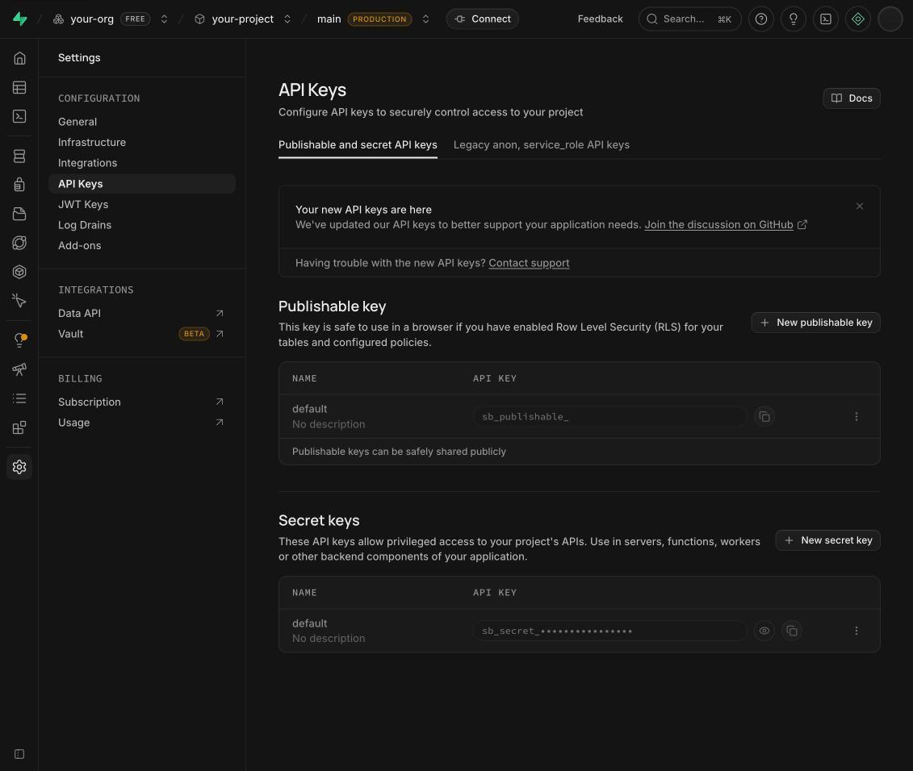

4. Click the **Legacy anon, service_role API keys** tab. Click **Reveal** on the `service_role`
   row and copy it into `.env.local` as `SUPABASE_SERVICE_ROLE_KEY`.

   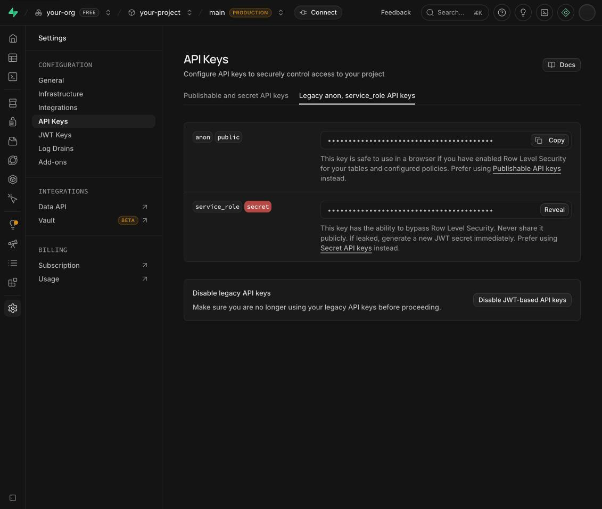

The `service_role` key can read and write everything in your project. Keep it out of public places.

**Which key does the code accept?** The legacy `service_role` key is a JWT. It is the format every
part of the project sends, so use it. A newer `sb_secret_...` key from the first tab is also
accepted by `npm run setup`, which sends it the way Supabase requires. The app passes it unchanged
to Supabase's JavaScript client. Not every path has been tested with it, and the optional Community
Notes job sends its key as a Bearer token. If a newer key gives you 401 errors, switch to the legacy
one.

### 3. X: sign-in and your bookmarks

1. Go to the [X Developer Console](https://console.x.com) and sign in with your X account.
2. Open **Apps → Create App**. Any name works.
3. Open **Billing → Credits** and click **Purchase credits**. A few dollars is plenty to start.
   Leave Auto Recharge off if you want a hard stop when the balance runs out. These credits pay for
   X only. Grok is billed separately in step 4.

   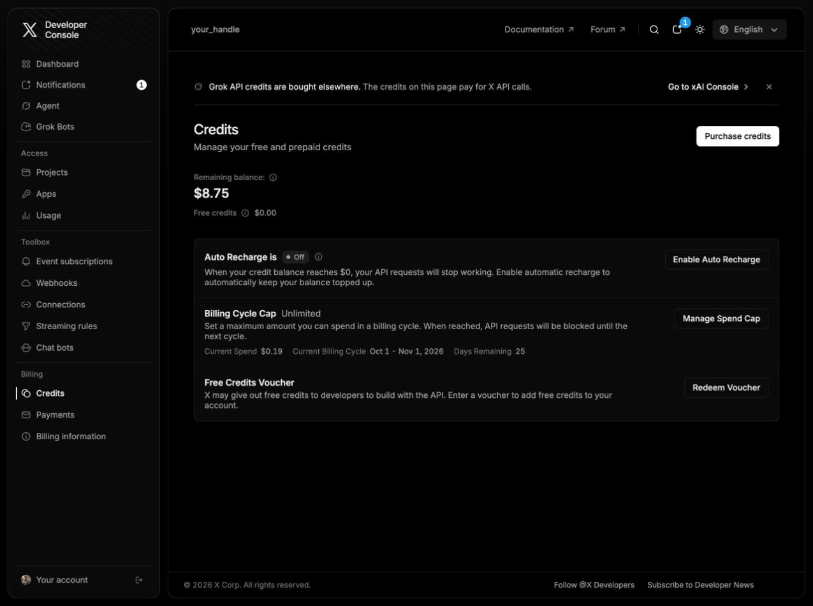

4. Open the app and click **Settings**. Under **Authentication settings**, set:
   - **App permissions:** Read
   - **Type of App:** Web App, Automated App or Bot (a confidential client)
   - **Callback URI / Redirect URL:** `http://localhost:3000/api/auth/callback/x`
   - **Website URL:** anything valid, such as your X profile address

   Save the page.

   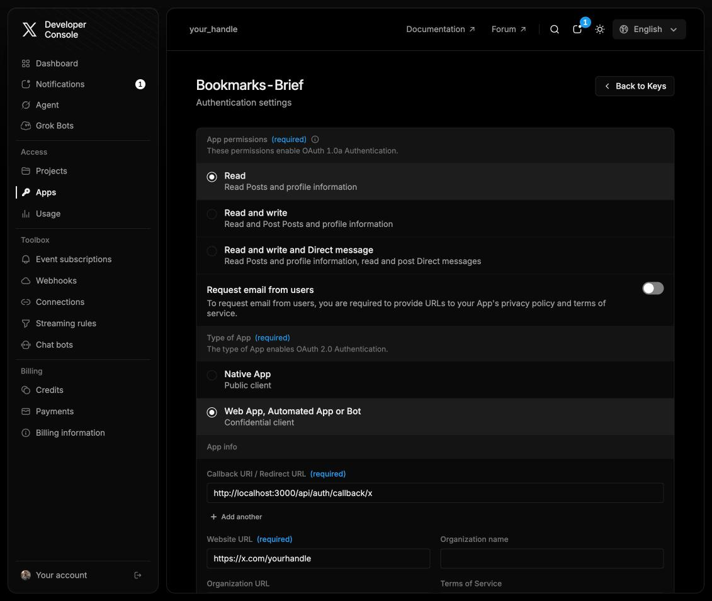

5. Go back to the app page and open the **Keys & Tokens** tab. Under **OAuth 2.0 Keys**, copy the
   **Client ID** and **Client Secret** into `.env.local` as `X_CLIENT_ID` and `X_CLIENT_SECRET`.
   Ignore the other rows. The app does not use them.

   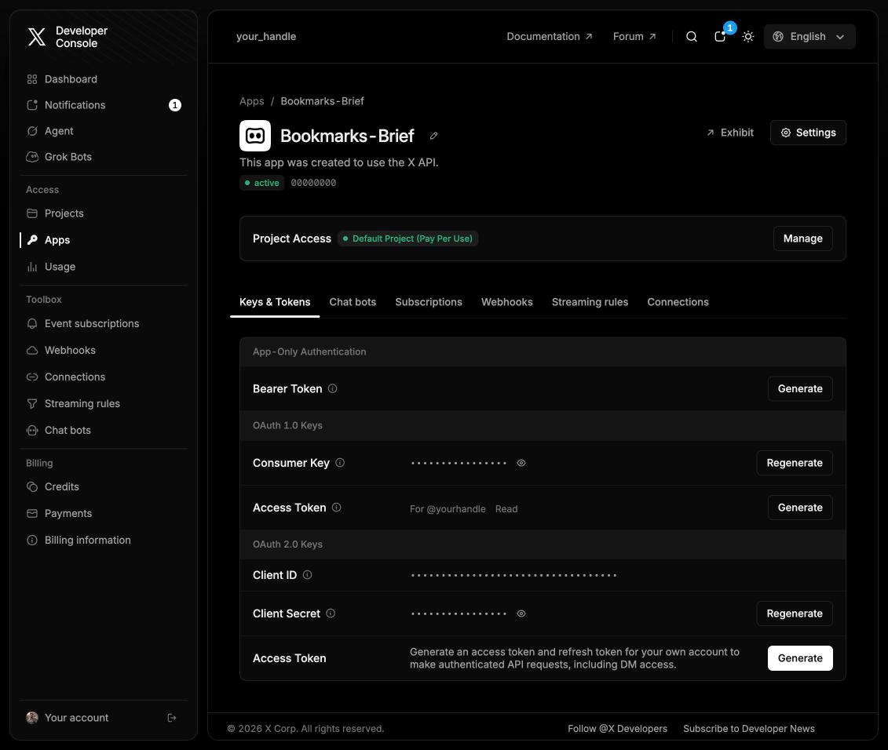

### 4. xAI: Grok

1. Open the [xAI console](https://console.x.ai). On the dashboard, add a few dollars of credits
   (**Credits remaining → Add**).
2. Click **Create API key** and copy the key into `.env.local` as `XAI_API_KEY`.

   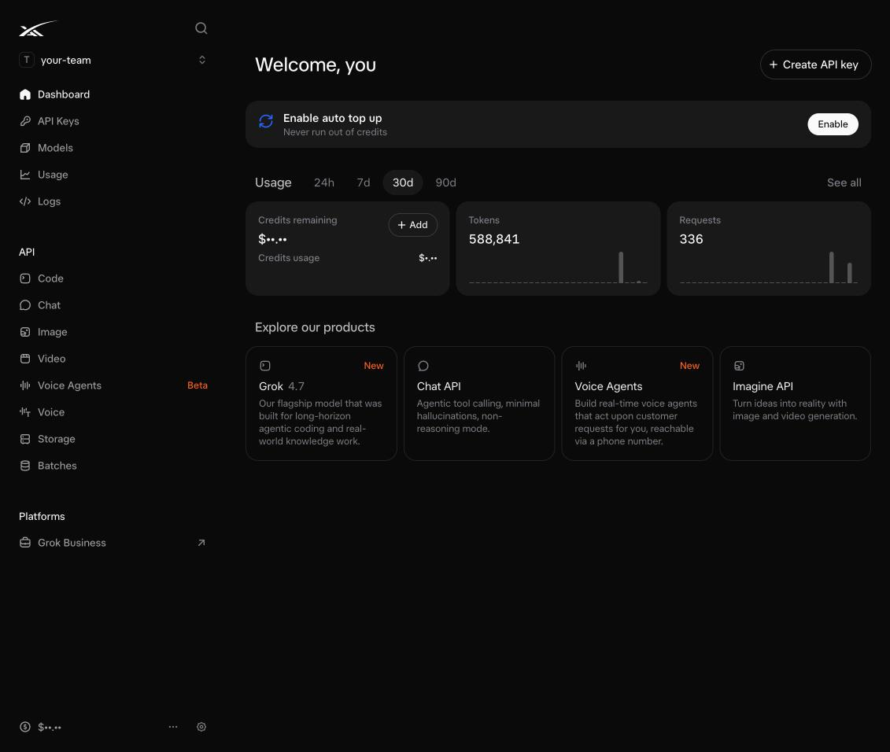

   You can find the key again later under **API Keys**.

   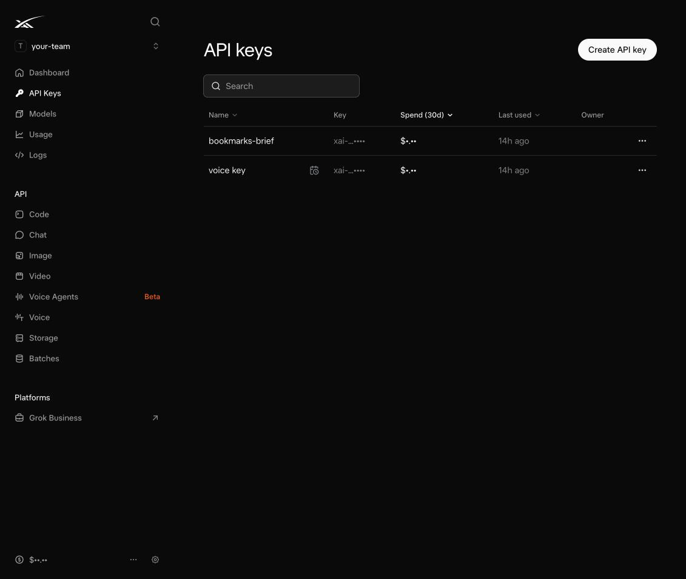

The same key powers Grok Voice for the podcast. That is the default, so there is nothing else to set
up. Want [ElevenLabs](https://elevenlabs.io) voices instead? Make a key there (profile → API Keys)
and paste it into the app's Voices panel after you sign in. You do not need to edit any file.

### 5. Run the setup script

```bash
npm run setup
```

The script:

- checks every value in `.env.local` and tells you which ones are missing;
- generates `APP_ENCRYPTION_KEY` and `SESSION_SECRET` for you, so you do not make those;
- creates the database tables and the private `episodes` storage bucket;
- checks your xAI key (and your ElevenLabs key, if you set one) with free calls.

It creates the database in one of two ways. With a Supabase personal access token it does the work
for you. Make one on the [Supabase tokens page](https://supabase.com/dashboard/account/tokens), put
it in `.env.local` as `SUPABASE_ACCESS_TOKEN`, and run the script. It asks y/N before it changes
anything. Without a token, it writes the whole database setup to a SQL file and prints the link to
your project's SQL editor. Paste the file there and press Run. Only use the token on your own
computer, never on a host.

To re-check at any time without changing anything:

```bash
npm run setup -- --check
```

Look for a tick (✓) next to every required line.

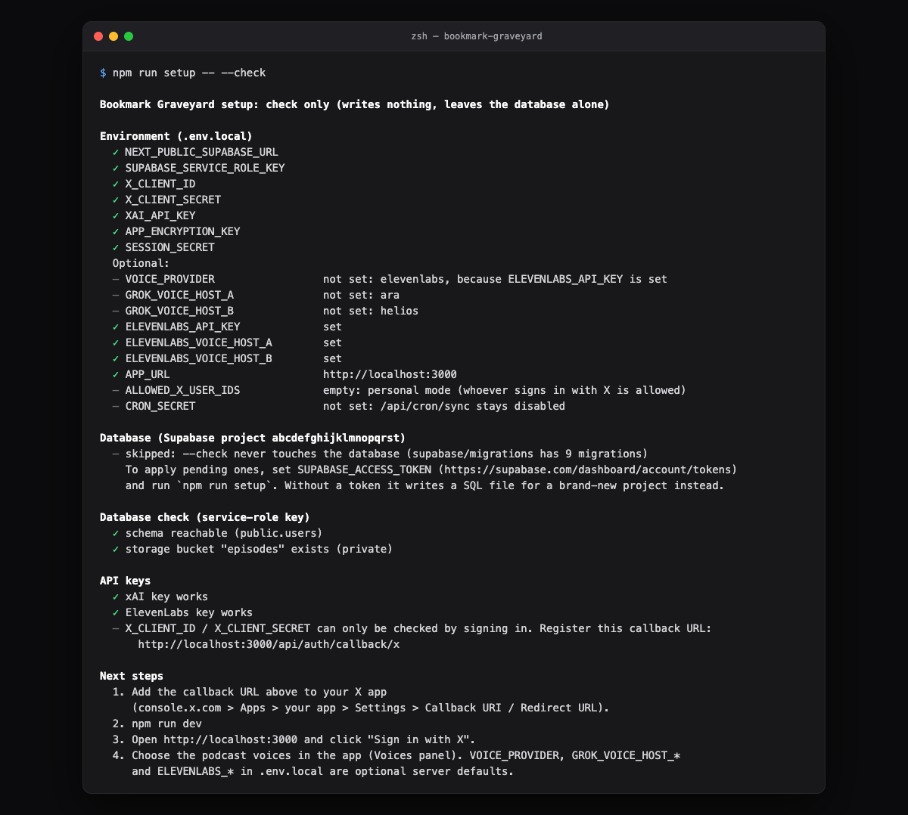

### 6. Start it

```bash
npm run dev
```

Open `http://localhost:3000` and click **Sign in with X**. Approve the app. Your bookmarks start
loading right away.

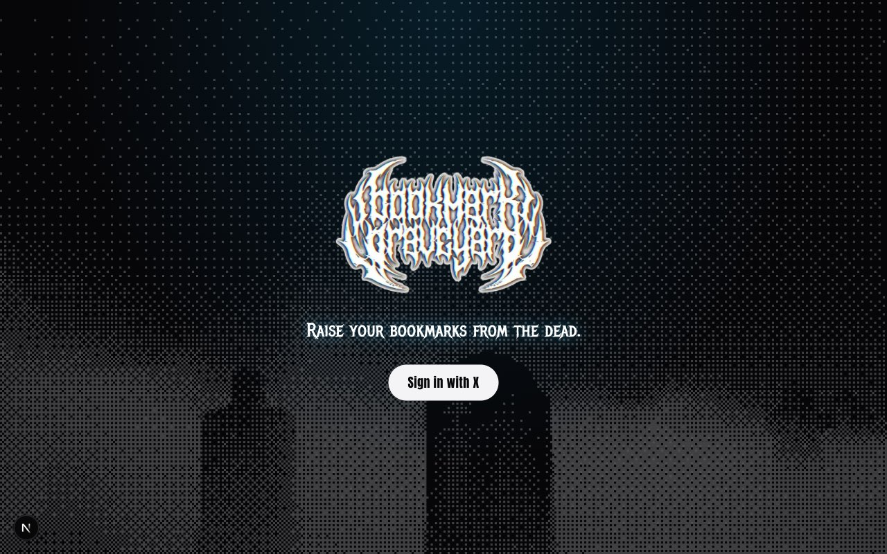

## Using it

**First sign-in and sync.** The first time you open the app with an empty library, it pulls your
bookmarks from X by itself. After that, **Check X for new** pulls your whole list again. X only
shows your newest ~800 bookmarks, and it does not tell the app when you saved each one. Posts
appear as soon as they arrive. Topics and summaries fill in a few seconds later.

**Pick a format.** "How would you like your summary?" offers **Markdown** or **Markdown + Podcast**.
Markdown needs no voice setup.


**Filters and topics.** **Posted between** limits the brief to posts published in a date range. It
starts at the last seven days. The topic chips below it are the tags Grok found, each with a count.
Click a chip to narrow the list to that topic.

**Hand-pick posts.** Click posts in **Your bookmarks** to choose exactly which ones go in. The
button then reads "Create my brief (N selected)". The × on a post removes it for good. That is a
local hide. The app cannot un-bookmark on X, because it only has read access.

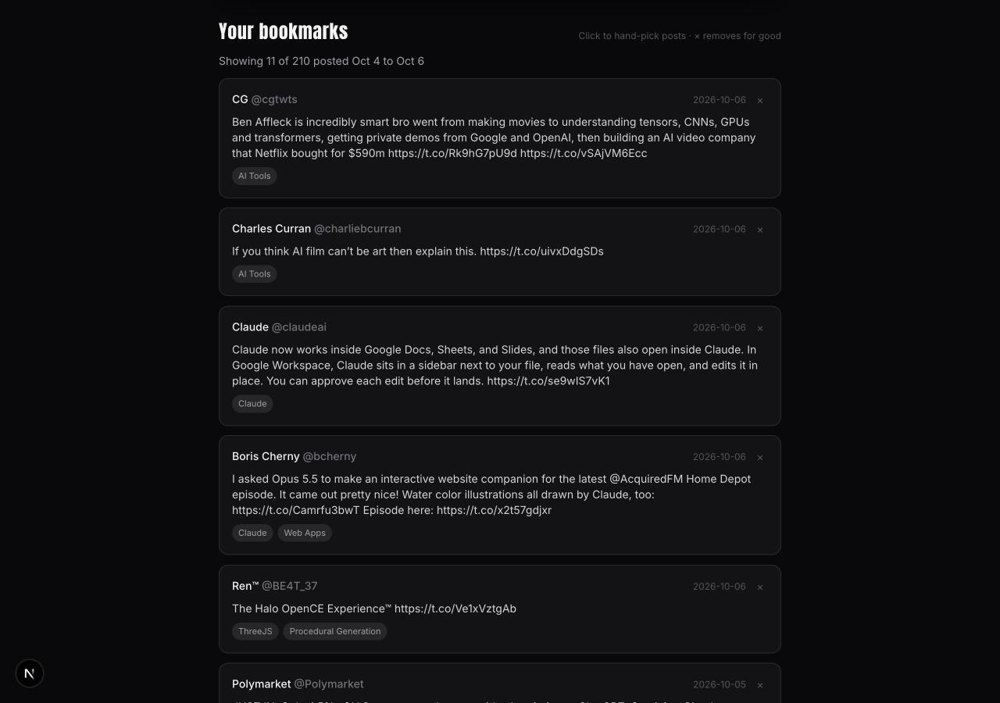

**Voices.** The Voices row shows who will host the podcast. Click **Change** to open the panel. Pick
**Grok Voice** or [ElevenLabs](https://elevenlabs.io). Paste your own key, or leave the field blank
to use the one in `.env.local`. Click **Load voices**, then choose Host A (Alex, the curious one)
and Host B (Blake, the analyst). **Preview** plays a one-sentence sample. **Save voices** keeps your
choice. **Use instance defaults** puts it back.

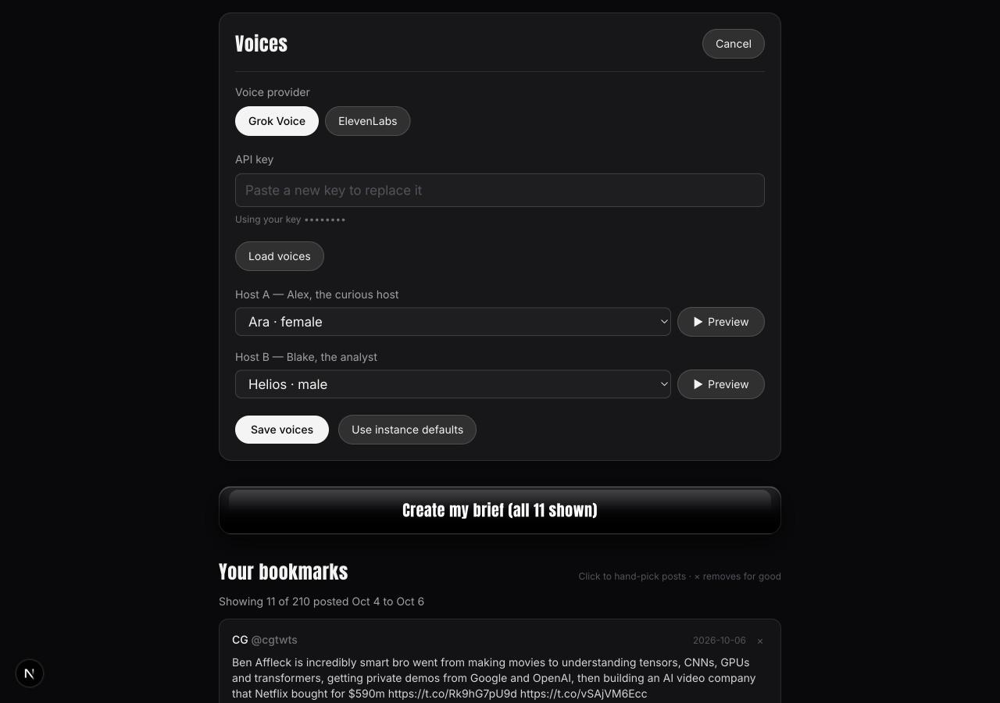

**Create my brief, then listen or read.** A progress bar shows each stage while the brief is
written and, for a podcast, voiced line by line. Finished briefs collect under **Previous briefs**.
Each has an audio player and **Download markdown**. Every idea in the markdown links back to the
post it came from. If something is interrupted, a **Resume** button picks up where it stopped.

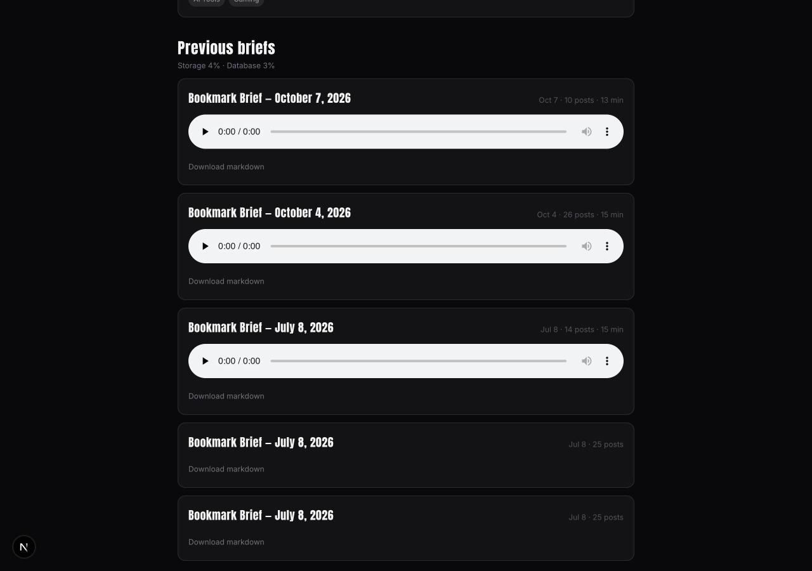

**Weekly sync.** To have the app check X by itself, set `CRON_SECRET` to any long random string.
The `/api/cron/sync` address then syncs and analyzes new bookmarks for everyone allowed to sign in.
`render.yaml` and `vercel.json` already schedule it for Fridays at 12:00 UTC. Without
`CRON_SECRET` it stays off.

## Works with your AI assistant

You can connect Bookmark Graveyard to an AI assistant and then ask it things in plain chat: "What did
I save about open-source licenses?" or "Make me a podcast from last week's AI bookmarks." The
assistant can search your bookmarks, read your finished briefs and start a new one. It works with
[Grok](https://grok.com), [Claude](https://claude.ai), [ChatGPT](https://chatgpt.com), editors such
as [Cursor](https://cursor.com), and any other assistant that supports
[MCP](https://modelcontextprotocol.io). MCP, the Model Context Protocol, is an open standard that
lets an assistant use tools in another app, so one connector serves all of them.

Your instance has one connector address: your `APP_URL` plus `/api/mcp`, such as
`https://your-domain/api/mcp`. Assistants reach it over the internet, so use your deployed address.
To try it from your own computer, see [SETUP.md](SETUP.md#connecting-an-assistant-mcp).

There are two ways to let an assistant in:

- **Sign in.** Some assistants can sign in for you: claude.ai, ChatGPT custom connectors, and
  grok.com if its connector screen offers sign-in. Add the connector address. A page from your
  instance opens and says what the assistant is asking for. Click **Approve**. If you are not signed
  in, it sends you through X first. There is nothing to copy.
- **A token.** Other assistants want a secret to send with every request, called a bearer token. It
  works like an API key. On the dashboard, open the **Assistants** panel (just below Voices) and
  click **Set up**. Name the token (say, "Grok"), choose **Read only** or **Read and write**, and
  click **Create token**. Copy it right away, because it is shown once. Paste it where the assistant
  asks for a token, an API key or an authorization header.

Make one token per assistant, so you can cancel one without breaking the others. Anyone who has a
token can read your bookmarks as you, so keep it as private as a password. Choose **Read only**
unless you want the assistant to start briefs.

Menu names in other companies' apps change often, so the steps below say what to look for. Each link
goes to that company's current guide.

### Grok

- **[grok.com Connectors](https://grok.com/connectors).** Click **New Connector**, choose
  **Custom**, paste the connector address, then finish the authentication step: sign in if it
  offers that, or give it a token. [xAI's connector guide](https://docs.x.ai/grok/connectors#custom-mcp-connectors)
  has the current steps. Grok refuses addresses on your own computer, so use your deployed instance
  or a [tunnel](https://docs.x.ai/grok/connectors/custom-mcp-tunneling).
- **[Grok Bot](https://docs.x.ai/grok-bot/overview).** Look for **Connect apps** in the sidebar, or
  ask the Bot to add an MCP server by its address
  ([xAI's guide](https://docs.x.ai/grok-bot/computer-and-apps)). Give it the connector address and,
  if it asks, a token. Then a [routine](https://docs.x.ai/grok-bot/skills-routines-and-automations)
  can use it: "Every Friday at 9:00, start a podcast brief of my last seven days of bookmarks. Check
  on it until it is done, then post the title and the audio link."

### Claude Code

[Claude Code](https://code.claude.com/docs/en/mcp) is Anthropic's coding assistant for the terminal.
To connect with sign-in:

```bash
claude mcp add --transport http bookmark-graveyard https://your-domain/api/mcp
```

Then run `/mcp` inside Claude Code and follow its sign-in. To connect with a token instead:

```bash
claude mcp add --transport http bookmark-graveyard https://your-domain/api/mcp \
  --header "Authorization: Bearer <token>"
```

### claude.ai and ChatGPT

Both connect by signing in, so you do not need a token.

- **[claude.ai](https://claude.ai).** Look for **Connectors** in the settings (it has been under
  Customize), choose to add a custom connector, give it a name and paste the connector address.
  [Anthropic's help article](https://support.claude.com/en/articles/11175166-get-started-with-custom-connectors-using-remote-mcp)
  has the current steps. Choose to sign in, then approve on the page that opens.
- **[ChatGPT](https://chatgpt.com).** Look in the settings for apps or connectors and an option to
  add a custom one. Some plans do not offer it, and it may sit behind a developer mode switch. Paste
  the connector address and approve on the page that opens.
  [OpenAI's MCP guide](https://developers.openai.com/api/docs/mcp) explains the terms.

### Cursor and other editors

[Cursor](https://cursor.com/docs/mcp) and other editors with MCP support take the connector address
and an `Authorization` header. In Cursor, put this in `mcp.json`:

```json
{
  "mcpServers": {
    "bookmark-graveyard": {
      "url": "https://your-domain/api/mcp",
      "headers": { "Authorization": "Bearer <token>" }
    }
  }
}
```

The file format differs from editor to editor, so follow your editor's MCP guide. Grok Build, xAI's
command-line tool, takes the same two pieces:
`grok mcp add --transport http bookmark-graveyard https://your-domain/api/mcp --header "Authorization: Bearer <token>"`
([xAI's guide](https://docs.x.ai/build/features/mcp-servers)). Any other MCP client works the same
way: give it the address and the header `Authorization: Bearer <token>`.

### What the assistant can do

The connector gives an assistant seven tools. You never call them yourself. You ask in chat, and the
assistant picks the right one.

- **Search your bookmarks** (`search_bookmarks`). Finds posts by words, topic, date posted, or
  "flagged as disputed or misleading". Each result has the post, its summary, key claims and topics.
  It searches your newest 1,000 visible bookmarks.
- **List your topics** (`list_topics`), with how many posts carry each.
- **List your briefs** (`list_episodes`), newest first, with links to the markdown and the audio.
- **Read a brief** (`get_episode`): the full text, and the podcast script if asked.
- **Check on a brief** (`get_brief_status`) that is being written.
- **Start a brief** (`generate_brief`): markdown or podcast, from a date range, topics or hand-picked
  posts. It needs read-and-write access.
- **Hide a bookmark** (`hide_bookmark`) from your library and every future brief. It needs
  read-and-write access. The app cannot unhide it yet, and it does not touch X.

Only starting a brief costs money. It spends one of your daily brief allowances and your xAI credits
(plus voice credits for a podcast), the same as pressing **Create my brief**. If the assistant asks
it to check X for new bookmarks first, X charges for those reads too. Everything else only reads
what the app has already stored, so it is free.

### Example prompts

- "What did I bookmark about MCP last month?"
- "Which topics do I save the most? Show me the top ten."
- "Read my latest brief and give me the five points worth remembering."
- "Make a markdown brief of my AI agent bookmarks from the past week, and tell me when it is ready."
- "Make a podcast from everything I saved last week and give me the audio link."

### Good to know

- A markdown brief takes about 3 minutes, and a podcast about 12. The assistant starts it, then
  checks on it about once a minute until it is done.
- Links the assistant shares keep working, but they open only after you sign in. On a device where
  you are not signed in to Bookmark Graveyard, you land on the sign-in page. Sign in, then open the
  link again.
- On [Vercel](https://vercel.com) and similar hosts, background work is
  [cut off after five minutes](https://vercel.com/docs/functions/configuring-functions/duration). A
  long podcast then needs the assistant to keep checking in, and each check carries it forward. On
  [Render](https://render.com) and other always-on hosts it finishes on its own.
- Bookmark text is written by other people. The assistant is told to treat it as information, not
  as instructions, but no assistant is perfectly safe from a post that tries to steer it. Give
  read-and-write access only to assistants you trust.
- To cut an assistant off, click **Revoke** next to its token in the Assistants panel. Assistants
  that connected by signing in are listed there too, tagged "Connected by sign-in". The assistant
  loses access on its next request.

## Deploy anywhere

Bookmark Graveyard is a standard Node.js app. Use any host that runs Node 22+ and takes environment
variables. [Render](https://render.com) is what the author uses. [Vercel](https://vercel.com) works
too. Neither is required.

[](https://render.com/deploy?repo=https://github.com/im-trustworthy/bookmark-graveyard)

`render.yaml` is a Render Blueprint. It creates the web service and the weekly sync job, then asks
you for each environment variable.

[](https://vercel.com/new/clone?repository-url=https%3A%2F%2Fgithub.com%2Fim-trustworthy%2Fbookmark-graveyard&project-name=bookmark-graveyard&repository-name=bookmark-graveyard&env=NEXT_PUBLIC_SUPABASE_URL,SUPABASE_SERVICE_ROLE_KEY,X_CLIENT_ID,X_CLIENT_SECRET,XAI_API_KEY,APP_ENCRYPTION_KEY,SESSION_SECRET,APP_URL&envDescription=Values%20from%20your%20.env.local%20(see%20SETUP.md))

`vercel.json` adds the weekly sync cron. The button asks for eight values, all straight from your
`.env.local`. The two optional ones for a deployed instance, `GATE_PASSWORD` and `CRON_SECRET`, are
explained below; add them under the project's environment variables if you want them.

After you deploy:

1. **Add the production callback URL in your X app.** In the X Developer Console, open the app's
   Settings and use "Add another" under Callback URI. The URL is
   `https://your-domain/api/auth/callback/x`.
2. **Set `APP_URL`** to your public address, with no trailing slash.
3. **Set `ALLOWED_X_USER_IDS`** to a comma-separated list of X user IDs. This is the one that
   matters: only those accounts can sign in. Without it, anyone who completes X sign-in can use
   your instance and your API keys. Your own X user ID is shown next to **Log out** after you sign
   in.
4. **Set `CRON_SECRET`** if you want the weekly sync.
5. **Optionally set `GATE_PASSWORD`.** It puts a single shared password in front of every page,
   including the landing page, for people who want the instance unlisted. Leave it unset for no
   wall. A few endpoints stay open on purpose, including the assistant connector at `/api/mcp`,
   because each one has its own lock. [SETUP.md](SETUP.md#what-the-password-gate-leaves-open) lists
   them.

**Fully local.** You can run the database on your own computer too. Install
[Docker](https://www.docker.com) and the
[Supabase CLI](https://supabase.com/docs/guides/local-development). In this folder, run
`supabase init` once and then `supabase start`. It applies the same database files and prints a
local URL and keys. Put them in `.env.local` as `NEXT_PUBLIC_SUPABASE_URL` and
`SUPABASE_SERVICE_ROLE_KEY`. X, xAI and the voice provider are still online services.

[SETUP.md](SETUP.md) has the long version of all of this.

## Costs

Prices as of October 2026.

| What | Price | In practice |
| --- | --- | --- |
| X: reading bookmarks | $0.001 per post read | Each check re-reads your whole list: a few cents for a small library, at most about $0.80 for 800 posts |
| [Grok](https://x.ai): tagging, summaries and writing the brief | Per token, with a cheap model for bulk work and a smarter one for writing | Typically well under $1 a month for a sync and a weekly brief |
| AI assistant: searching and reading | Free | Reads what the app already stored and spends no credits. Starting a brief from an assistant costs the same as the dashboard button |
| Podcast voice: Grok Voice | $15 per 1M characters, on the same xAI credits | About $0.20 per 15-minute episode |
| Podcast voice: [ElevenLabs](https://elevenlabs.io) Creator plan | $22 a month for 121,000 credits | About $1.25 per episode |
| Podcast voice: ElevenLabs usage-based | $0.04 per 1,000 characters (Turbo) | About $0.55 per episode |
| [Supabase](https://supabase.com) storage | Free tier includes 1 GiB | A 15-minute episode is about 13.5 MB, so roughly 70 episodes per free GiB before old audio is pruned |
| Hosting | Free on your own computer | Otherwise see [Render](https://render.com/pricing) and [Vercel](https://vercel.com/pricing) pricing |

Daily limits built into the app also stop a bug or a stolen session from running up a bill.
[ARCHITECTURE.md](ARCHITECTURE.md#cost-analysis) has the full analysis.

## Data & privacy

**What is stored**, in your own Supabase project:

- Your bookmarks: post text, author, links, media details and the raw data X returned.
- Text pulled from what you saved: linked article text, image descriptions and video transcripts.
- Topics, one-sentence summaries and key claims that Grok wrote.
- Your briefs: the markdown, the podcast script and the audio. The files sit in a private storage
  bucket called `episodes`. The app opens them with links that expire after 24 hours.
- Your X sign-in tokens, and any voice API key you paste into the Voices panel. Both are encrypted
  with AES-GCM under `APP_ENCRYPTION_KEY`. The panel shows a key's last four characters at most.
- Assistant access: a one-way hash of each assistant token (never the token itself), the assistants
  you approved by signing in, and a record of the briefs an assistant started.

**What leaves your server:**

- [X](https://console.x.com): sign-in, and reading your bookmarks.
- [xAI](https://console.x.ai): post and article text, image links and video audio go to Grok to be
  analyzed. The finished brief goes back to write the podcast script and, with Grok Voice, to speak
  it. Grok's live search runs on xAI's side when a post says its link is in the replies.
- [ElevenLabs](https://elevenlabs.io), only if you choose it: script lines to speak, and video audio
  to transcribe.
- An AI assistant you connect. Whatever it asks for, such as your bookmark text, summaries and
  briefs, goes to that assistant's company and is handled under its terms. Connect only assistants
  you trust with your reading list.
- The websites your bookmarks link to. The server fetches those articles, and it refuses private
  addresses.
- The optional daily [GitHub Actions](https://docs.github.com/actions) job downloads X's public
  [Community Notes data](https://communitynotes.x.com/guide/en/under-the-hood/download-data) and
  compares it with your bookmarked post IDs. Nothing about your bookmarks is sent to X. The job
  runs on GitHub with your Supabase key stored as a repository secret.

The app has no analytics and no telemetry. [Next.js](https://nextjs.org), the framework it is built
on, collects anonymous usage data from its command-line tool. Turn that off with
`npx next telemetry disable`.

**To delete everything,** delete your Supabase project in its dashboard. That removes the database
and every file. Then remove the app from your X account's connected apps, and delete the keys you
made at each service.

## Troubleshooting

**X shows an error instead of asking you to approve, or you land back on the sign-in page with
"Sign-in didn't complete."** The callback URL in your X app must match the one the app sends,
character for character. It is your `APP_URL` plus `/api/auth/callback/x`. Check `http` against
`https`, the port (`:3000`), a trailing slash and a `www.`. `npm run setup -- --check` prints the
exact URL to register. Also check that the app type is "Web App, Automated App or Bot" and that you
copied the Client ID and Secret from **OAuth 2.0 Keys**.

**"This account isn't on the allowlist for this instance."** Your X user ID is not in
`ALLOWED_X_USER_IDS`. Add it. Leaving the variable empty lets anyone who signs in through, which
only makes sense on your own computer.

**Pages fail to load or the database cannot be reached.** Free Supabase projects pause after about
a week without activity. Open the project in the [Supabase dashboard](https://supabase.com/dashboard)
and restore it. A deployed instance with the weekly sync running keeps itself awake.

**"Invalid API key for Grok Voice" (or ElevenLabs), or "The voice provider rejected the API key."**
Open **Voices → Change**, paste a fresh key, and click **Save voices**. The app checks the key by
loading that provider's voices. Other messages:

- "The voice provider refused the request": the key is fine, but the account may be out of credits
  or lack permission.
- "Your saved voice API key can't be read": `APP_ENCRYPTION_KEY` changed since you saved it. Enter
  the key again.
- A brief that stopped partway shows a **Resume** button. Fix the key first, then resume. Markdown
  briefs never need a voice key. If transcribing a video fails, the app describes its thumbnail
  instead.

**Storage is filling up, or old briefs lost their audio.** The dashboard warns at 80% of your
storage. When new audio would push storage past 90%, the app removes the oldest podcast audio until
there is room. It never touches the markdown, the bookmarks, or each person's newest briefs (four
by default). The warning's **Free up space** button previews that cleanup and runs it for you.
Four optional environment variables tune it:

- `STORAGE_LIMIT_BYTES`: the size to measure against. The default is 1 GiB, the free tier.
- `DATABASE_LIMIT_BYTES`: the database size to warn at. The default is 500 MiB. It only warns.
- `AUTO_PRUNE_AUDIO`: set to `false` to only warn. New audio is then refused when storage is full.
- `KEEP_RECENT_AUDIO`: how many of each person's newest briefs keep their audio. The default is 4.

**"Daily limit reached."** The app caps paid actions per person per day. Wait, or raise the cap with
`LIMIT_<KIND>_PER_DAY`, such as `LIMIT_SYNC_PER_DAY`. Assistant tool calls have their own cap,
`LIMIT_MCP_CALL_PER_DAY`, which is 1,000.

**An assistant says "unauthorized", or sign-in to it fails.** The connector address must be your
`APP_URL` plus `/api/mcp`, character for character, including `https`, any `www.` and any port. The
app builds its sign-in details from `APP_URL`, so a deployed instance whose `APP_URL` still says
`http://localhost:3000` cannot sign an assistant in. With a token, check that you copied all of it
(it starts with `bg_`) and that it has not been revoked or expired in the Assistants panel. Grok also
refuses `localhost` addresses.

## More

- [ARCHITECTURE.md](ARCHITECTURE.md): how it works inside, the pipeline, the data model and the
  full cost analysis.
- [SETUP.md](SETUP.md): the long setup guide, with every option.
- [ROADMAP.md](ROADMAP.md): what is planned, and what is blocked and why.
- [CONTRIBUTING.md](CONTRIBUTING.md): how to run it locally and send a pull request.
- [SECURITY.md](SECURITY.md): how to report a vulnerability.

## License

[MIT](LICENSE). Copyright (c) 2026 TW Labs LLC.
